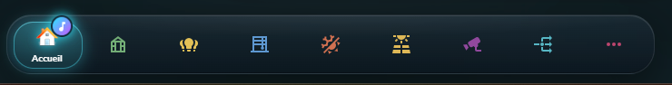
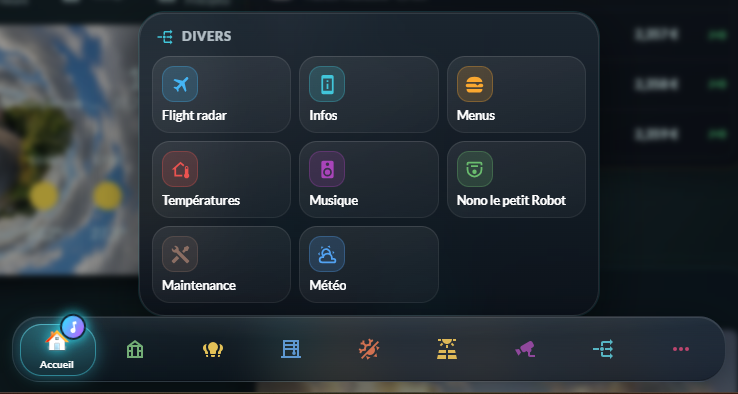
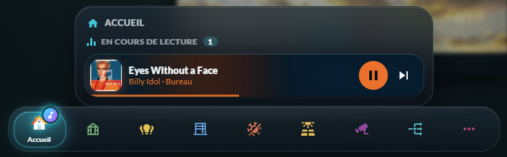
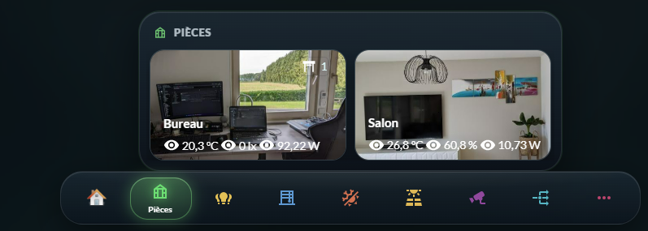
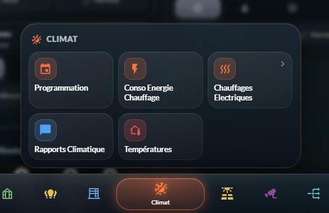
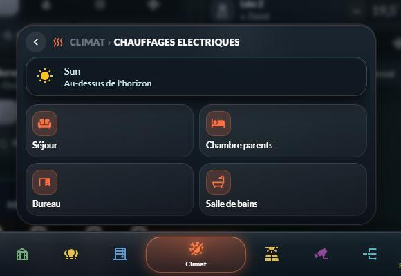
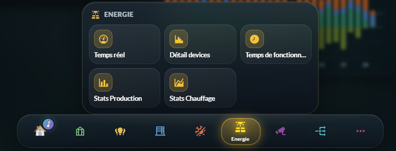
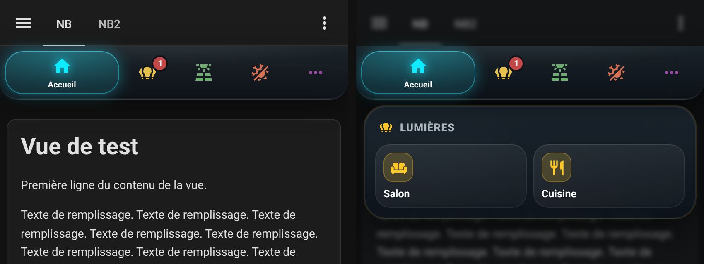
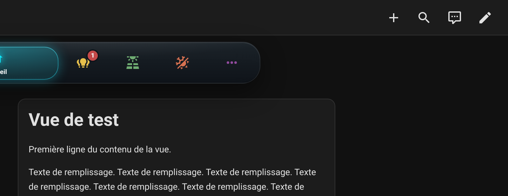
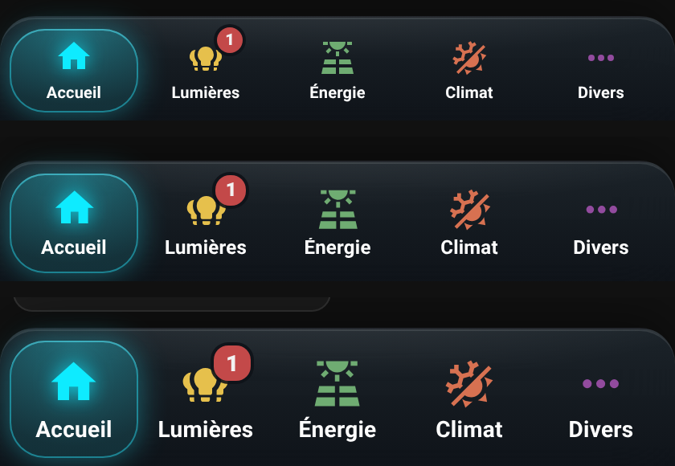

# 🧭 HOLM Navbar Card

[](https://hacs.xyz/)


[🇫🇷 Français](README.md) · 🇬🇧 English

**A frosted-glass navigation bar for your whole Home Assistant dashboard: animated, alive, and set up entirely with the mouse.**

HOLM Navbar Card places at the bottom of the screen (or on the side, on a computer) a **floating “liquid glass” dock** that links all the views of your dashboard. A glowing bubble slides from one tab to the next, icons bounce when tapped, **badges** count what is on or open, a **long press** opens a shortcut panel… and if music is playing in the house, **a little music note** tells you so.

> ✨ **Zero YAML.** Add the card from the card picker, create your tabs in the visual editor (icon, colour, view, sub-menus, badges…) and **the same bar shows on every view**.

### At a glance

- 🫧 **Animated glass dock**: sliding active bubble, coloured icons, bounce and vibration on tap.
- 🗂️ **One configuration for the whole dashboard**: a “main” card holds the tabs, the other views just get the card, with nothing to set.
- 🧩 **Several dashboards**: give the bar an ID and reuse it in your other dashboards, each with its own settings.
- 🚀 **No flicker**: the bar stays on the page when you change view.
- 📂 **Sub-menus** on long press: a panel of tiles to go to other views or **run an action** (script, scene, toggle a light…), with the entity's **live state** (Garage · Open, Alarm · Armed…).
- 🪆 **Nested sub-menus**: a tile can open its own sub-menu (long press), with a back button and breadcrumb.
- 🃏 **Lovelace cards in the panel**: thermostat, camera, chart… any card, added with **Home Assistant's card picker and card editor**.
- 🌍 **8 languages**: English, French, German, Spanish, Italian, Dutch, Portuguese, Polish (Home Assistant's language by default).
- 🔴 **Dynamic badges**: number of lights on, covers open, a sensor value…
- 🎵 **Music**: an animated note on the tab when a player is playing, **the playing players on long press**, and a **mini player** above the bar *(requires [HOLM Music Card](https://github.com/kaaribou/holm-music-card), see [Requirements](#requirements))*.
- 📱💻 **Mobile and desktop**: docked or floating on phones; bottom, left, right or hidden on large screens.
- 👤 **Per-user tabs**: a tab can be visible to certain people only.
- 🙈 **Hide on scroll** (optional) to leave all the room to the content.



*Screenshots in French — the card follows the language of your Home Assistant profile.*

| Sub-menu (long press) | Playing now (long press on Home) |
|---|---|
|  |  |

### 🆕 What's new in 1.8.0

- ⬆️ **Bar at the top** ([#8](https://github.com/kaaribou/holm-navbar-card/issues/8)): *Position on desktop* → **Top** (floating, under the Home Assistant header) and *On mobile* → **Docked at the top**. The view content moves down accordingly, sub-menus open downwards and the mini player sits under the bar. See [The bar at the top](#the-bar-at-the-top).
- 🔠 **Icon and text size** ([#9](https://github.com/kaaribou/holm-navbar-card/issues/9)): new **Size** option (Normal, Large, Extra large) that enlarges icons, labels, badges and bar height together; exact sizes in YAML with `icon_size` and `label_size`. See [Size](#icon-and-text-size).
- 👁️ **Conditional visibility** ([#10](https://github.com/kaaribou/holm-navbar-card/issues/10)): when Home Assistant hides a view's card (card *Visibility* tab: entity state, user, screen size…), the bar is hidden on that view, and comes back as soon as the condition is met. See [Hide the bar on a condition](#hide-the-bar-on-a-condition).
- Card-only update: refresh your browser (Ctrl+F5).

### What's new in 1.7.1

- 🌍 **Translations completed**: the 1.7.0 settings (bar ID, card role, settings for a view…) are now translated into German, Spanish, Italian, Dutch, Portuguese and Polish.
- 🇬🇧 English README.

### What's new in 1.7.0

#### 🧩 One bar for several dashboards
Give your main card an **ID** (e.g. `main`), then add a HOLM Navbar card to another dashboard and pick that bar in the list: the tabs come from the main card, wherever it is. Each dashboard can keep **its own settings** (colour, appearance, labels, position…). See [Several dashboards](#several-dashboards).

#### 🐛 The bar no longer disappears when switching dashboards
With the same main card copied into two dashboards, the bar could disappear after navigating; this is fixed (#7).

### What's new in 1.6.0

#### 🃏 Lovelace cards in sub-menus

A tab or a tile can now show **any Lovelace card** in its panel (area card, thermostat, camera, chart, your HOLM cards…). Here, the *Rooms* tab shows two area cards side by side:



- **One-click add** from a quick picker (search, Home Assistant cards and custom cards), then set up with Home Assistant's **card editor** (visual or code).
- **Sizing**: panel width (narrow to full width), **1 to 3 columns** of cards, and the width of each card (one or more columns, or the whole row).
- **Card actions work**: tapping the *Office* card opens the office view and closes the panel; long press and more-info too.
- Cards **alone** or **with tiles**, above or below.
- Cards follow Home Assistant's state live and are detached when the panel closes (no camera running in the background).

→ Details in [Cards in the panel](#cards-in-the-panel).

#### 🪆 Nested sub-menus

A **long press on a tile** opens its own sub-menu, up to **3 levels** (Climate › Heaters › Upstairs). Navigate with the **back ‹** button, the clickable **breadcrumb** or the **Esc** key. A tile with no view and no action opens its sub-menu with a simple tap; a small arrow marks tiles that have one.

#### 📝 Labels readable in full

Tile names wrap onto **2 lines** instead of being cut, with clean hyphenation of long words. *Label lines* option: 1, 2, 3 or unlimited.

#### 🌍 8 languages

Card and editor translated into **English, French, German, Spanish, Italian, Dutch, Portuguese and Polish**, following the language of your Home Assistant profile, or forced with the *Language* option. States shown on tiles use Home Assistant's official translations.

| Labels on 2 lines | Nested sub-menu with a card |
|---|---|
|  |  |

---

## Contents

- [Requirements](#requirements)
- [Installation](#installation)
- [Set up in 2 minutes](#set-up-in-2-minutes)
- [Several dashboards](#several-dashboards)
- [Tabs](#tabs)
- [Sub-menus](#sub-menus)
- [Cards in the panel](#cards-in-the-panel)
- [Badges](#badges)
- [Music](#music)
- [The bar at the top](#the-bar-at-the-top)
- [Icon and text size](#icon-and-text-size)
- [Hide the bar on a condition](#hide-the-bar-on-a-condition)
- [General options](#general-options)
- [Full YAML example](#full-yaml-example)
- [FAQ / troubleshooting](#faq--troubleshooting)

---

## Requirements

- **Home Assistant 2025.1** or newer.
- **For the music features only** (music note, playing players, mini player):

> [!IMPORTANT]
> The bar's music features **use the [HOLM Music Card](https://github.com/kaaribou/holm-music-card) player**: it is what shows in the “Playing now” panel and in the mini player.
> **So it must be installed**, along with the **[Music Assistant](https://music-assistant.io/)** integration in Home Assistant.
> HACS cannot install a “dependent” card automatically: install both cards, then reload the page.
>
> Without HOLM Music Card, the bar works normally; only the music features stay inactive (the editor tells you).

---

## Installation

### With HACS (recommended)

1. HACS → ⋮ menu → **Custom repositories**.
2. Add `https://github.com/kaaribou/holm-navbar-card`, category **Dashboard** (*Plugin*).
3. Search for **HOLM Navbar Card** → **Download**.
4. *(For music)* do the same with `https://github.com/kaaribou/holm-music-card`.
5. Reload the page (Ctrl + F5).

HACS adds the resource automatically and tells you about new versions.

### Manually

1. Copy `dist/holm-navbar-card.js` to `config/www/community/holm-navbar-card/`.
2. **Settings → Dashboards → ⋮ → Resources → Add**: `/local/community/holm-navbar-card/holm-navbar-card.js`, type **JavaScript module**.
3. Reload the page.

---

## Set up in 2 minutes

1. Open the main view of your dashboard (e.g. *Home*) → **Edit** → **Add card** → **HOLM Navbar**.
2. Create your tabs in the editor (label, icon, colour, view to open). This card becomes the **main card**.
3. In **each of the other views**, add the **HOLM Navbar** card too, **without setting anything**: it finds the main card's configuration on its own.

```yaml
# in the other views, that's all:
type: custom:holm-navbar-card
```

In edit mode, the card shows as a small preview (“main card” or “shared config”); in normal use it is invisible and **the bar appears at the bottom of the screen**. Any change to the main card is applied everywhere, instantly.

> 💡 A “secondary” view can still change `labels`, `desktop_position`, `mobile_style`, `auto_hide` or `size` locally (*Settings for this view* section of the editor; “Same as main card” = inherited).

---

## Several dashboards

By default, a card without tabs reuses the main card **of its own dashboard**. To reuse the same bar in **other dashboards**:

1. On the main card, fill in **Bar ID** (e.g. `main`).
2. In the other dashboard, add a **HOLM Navbar** card: if that dashboard has no bar yet, it automatically reuses the shared bar. Otherwise, choose **Reuse the bar “main”** in **Role of this card**.

> 💡 **Role of this card**, at the top of the editor, lets you switch a card at any time from “Main bar” (tabs defined here) to “Reuse…” (tabs coming from another card), and back.

```yaml
# main card ("Home" dashboard)
type: custom:holm-navbar-card
navbar_id: main
routes:
  - label: Home
    icon: mdi:home
    url: /lovelace/home
  - label: Energy
    icon: mdi:flash
    url: /dashboard-energy/0

# in any other dashboard
type: custom:holm-navbar-card
navbar_id: main
accent: "#ff7043"   # optional: settings for this dashboard
```

- Tabs are edited **on the main card only**; every change is picked up everywhere.
- A card reusing a bar by ID can keep its own `accent`, `theme`, `labels`, `label_lines`, `desktop_position`, `mobile_style`, `auto_hide`, `size` and `haptic`. Any setting left on “Same as main card” is inherited.
- Use **full addresses** in tabs (`/lovelace/home`, `/dashboard-energy/0`) so each tab opens the right dashboard wherever it is tapped.
- The bar is remembered on the device: it shows immediately, then updates if the main card has changed.
- Dashboards in YAML mode (file) are not read: put the main card in a dashboard managed from the UI.

---

## Tabs

| Setting | Description |
|---|---|
| **Label** | Text under the icon (shown according to the *Labels* option). |
| **Icon** / **Image** | An `mdi:` icon or an image (`/local/…png`) that replaces it. |
| **Colour** | Colour wheel, or `#hex`, `rgb(…)` or a theme colour name (`red`, `amber`…). Colours the icon and the bubble. |
| **View to open** | The view path (`/lovelace/lights`). The tab lights up when you are on this view **or** on a view of its sub-menu. |
| **On tap** | Go to a view (default), toggle the entity, open its more-info, run an action… |
| **Badge** | Entities to count (see [Badges](#badges)). |
| **Music note…** | Turns on the music indicator and the list of players on long press (see [Music](#music)). |
| **Visible only to** | Home Assistant user names. Empty = everyone. |

A tab **with a view** goes there on tap and opens its sub-menu on long press. A tab **without a view** opens its sub-menu directly.

---

## Sub-menus

Each tab can hold **tiles** shown in a glass panel on long press:

- a tile with a **view** takes you there;
- a tile with an **action** (`perform-action`: `script.good_night`, `light.turn_off`…) runs it without closing the panel;
- a tile linked to an **entity** shows **its live state** and lights up when active; a long press opens its more-info.

Long labels wrap (2 lines by default, **Label lines** option).



### 🪆 Nested sub-menus

In the editor, each sub-menu tile has its own **Sub-menu** section too:

- a tile **with a view or an action** keeps its tap behaviour, and **its sub-menu opens on long press**;
- a tile **with no view and no action** opens its sub-menu **with a simple tap**;
- a small › arrow marks tiles that have a sub-menu;
- the panel slides to the next level; **‹** (or the Esc key) goes back, and tapping the breadcrumb jumps straight to a level;
- up to **3 levels**: tab → sub-menu → sub-sub-menu.

---

## Cards in the panel

Each tab and each sub-menu tile can show **Lovelace cards** in its panel: a thermostat in the *Heating* sub-menu, the gate camera in *Security*, a consumption chart in *Energy*…

1. In the editor, open the tab or tile, **Cards** section → **Add card**.
2. Choose the card type in **the quick picker**: type a few letters to filter, and the card is added with a starting configuration. The “Show previews” link opens Home Assistant's full picker, which is slower.
3. Set it up with **the card editor**; the `{ }` button switches to the code editor.
4. If the panel also has tiles, choose the **cards position**: above (default) or below the tiles.

A tab or tile with **only cards** (no tiles) opens its card panel directly. Cards receive Home Assistant's state live and are detached when the panel closes (a camera doesn't run in the background).

Card actions (tap, long press, navigation, more-info…) work as on a dashboard.

### Sizing the cards

| Setting | Effect |
|---|---|
| **Panel width** | automatic, narrow (360 px), normal (460 px), large (640 px), extra large (860 px) or full width |
| **Card columns** | 1, 2 or 3 cards side by side |
| **Card width** | for each card, the number of columns it takes, or the whole row |

The number of columns is kept on phones too (choose 1 column if you prefer stacked cards).

```yaml
cards_columns: 2
panel_width: large
cards:
  - type: area
    area: office
  - type: tile
    entity: light.office
cards_size:
  - null            # 1 column
  - { span: full }  # whole row
```

---

## Badges

- **Count entities**: choose several entities; the badge shows how many are *active* (on, open, playing, unlocked, alarm armed…).
- **A value** (YAML): `badge: { entity: sensor.xxx }` shows the value if positive, or a pulsing dot if the entity is active.
- **Colour** (YAML): `badge: { color: amber }`.

---

## Music

> [!IMPORTANT]
> Requires **[HOLM Music Card](https://github.com/kaaribou/holm-music-card)** + the **Music Assistant** integration.

### 🎵 The music note on a tab

Turn on **“Music note when playing + players on long press”** on the tab of your choice (e.g. *Home*):

- as soon as **a Music Assistant player is playing**, an **animated music note** appears on the tab;
- if several are playing, it shows their **number** (♪ 2);
- **grouped** speakers (multiroom) count as one player.

### 🎧 Playing players on long press

A **long press** on this tab opens the **“Playing now”** panel: a **mini player** per speaker playing (or paused), with artwork, progress and play/pause. **Tapping a mini player opens the full player** (queue, library, speakers…). If the tab also has sub-menu tiles, they show below.


### 📻 The mini player above the bar

In the main card's **Music mini player** section:

| Setting | Description |
|---|---|
| **Music Assistant mini player** | The player always shown above the bar. |
| **Show the mini player** | *Only while playing* (default) or *Always*. |
| **Artwork style** | Square artwork or spinning vinyl. |
| **Watched players** | Players taken into account by the music note and the panel. Empty = **all** Music Assistant players. |

---

## The bar at the top



- **On mobile** → **Docked at the top** (`mobile_style: top`): the bar sticks under the Home Assistant header, full width, rounded corners at the bottom.
- **Position on desktop** → **Top** (`desktop_position: top`): the bar floats in the centre, under the header.



At the top:

- the **view content** moves down so it never goes under the bar;
- if the Home Assistant header is hidden (kiosk-mode…), the bar goes to the very top of the screen;
- **sub-menus** (long press) open **downwards**, under the bar;
- the music **mini player** sits under the bar;
- **Hide on scroll** slides the bar upwards.

Like the other positions, it can be chosen for a single view (*Settings for this view* section).

## Icon and text size



**Size** (`size`) enlarges icons, labels, badges and the bar height together (and the side rail width):

| Value | Icons | Labels |
|---|---|---|
| **Normal** (`normal`) | 24 px | 10 px |
| **Large** (`large`) | 29 px | 12 px |
| **Extra large** (`xlarge`) | 34 px | 14 px |

For exact values (YAML): `icon_size: 30` and `label_size: 13` (in pixels); the bar grows to fit them. Size can also be set for a single view (larger on a wall tablet, for instance).

## Hide the bar on a condition

The card's **Visibility** tab (or `visibility:` in YAML) works: when the condition is not met, Home Assistant hides the card **and the bar disappears from that view**; it comes back as soon as the condition is met again, without reloading. All Home Assistant conditions work: entity state, numeric value, user, screen size, and / or / not.

```yaml
# hide the menu while the alarm is armed
type: custom:holm-navbar-card
visibility:
  - condition: state
    entity: alarm_control_panel.alarm
    state: disarmed
```

The condition applies to the view the card is in: put it on the card of each view concerned (main card included).

## General options

| Option | Values | Default |
|---|---|---|
| `navbar_id` | bar ID: on the main card, to share it; on another card, to reuse that bar | — |
| `theme` | Appearance: `auto` (follows light / dark mode), `dark`, `light`, `theme` (your theme's colours) | `auto` |
| `labels` | `active` (active tab), `all`, `none` | `active` |
| `mobile_style` | `docked` (stuck to the bottom), `floating`, `top` (docked at the top) | `docked` |
| `desktop_position` | `bottom`, `top`, `left`, `right`, `hidden` | `bottom` |
| `size` | `normal`, `large`, `xlarge`: size of icons, labels and the bar | `normal` |
| `icon_size` / `label_size` | (YAML) exact icon / label size, in px | from `size` |
| `auto_hide` | hide the bar when scrolling | `false` |
| `haptic` | vibration on tap (mobile app) | `true` |
| `accent` | main colour | `#26c6da` |
| `label_lines` | label lines: `1`, `2`, `3`, `0` (unlimited) | `2` |
| `language` | `auto` (HA language), `fr`, `en`, `de`, `es`, `it`, `nl`, `pt`, `pl` | `auto` |
| `music_entity` | mini player's player | — |
| `music_show` | `active`, `always` | `active` |
| `music_artwork` | `square`, `vinyl` | `square` |
| `music_players` | list of watched players | all |

Per tab or per tile: `popup` (sub-menu tiles, nestable), `cards` (list of Lovelace cards), `cards_position` (`top` or `bottom`), `panel_width` (`narrow`, `normal`, `large`, `xlarge`, `full`), `cards_columns` (`1` to `3`), `cards_size` (width of each card: `{ span: 2 }` or `{ span: full }`).

---

## Full YAML example

```yaml
type: custom:holm-navbar-card
labels: active
mobile_style: docked
desktop_position: bottom
music_entity: media_player.living_room
music_show: active
routes:
  - label: Home
    icon: mdi:home
    url: /lovelace/home
    color: "#26c6da"
    music: true
  - label: Lights
    icon: mdi:lightbulb-group
    url: /lovelace/lights
    color: "#ffca28"
    badge:
      entities: [light.living_room, light.kitchen, light.office]
  - label: More
    icon: mdi:dots-horizontal
    color: "#ab47bc"
    popup:
      - label: Garage
        icon: mdi:garage
        entity: cover.garage
        tap_action: { action: toggle }
      - label: Good night
        icon: mdi:weather-night
        tap_action:
          action: perform-action
          perform_action: script.good_night
      - label: Weather
        icon: mdi:weather-partly-cloudy
        url: /lovelace/weather
  - label: Climate
    icon: mdi:sun-snowflake-variant
    url: /lovelace/heating
    color: "#ff7043"
    popup:
      - label: Electric heaters
        icon: mdi:radiator
        url: /lovelace/electric-heaters   # tap: the view; long press: the sub-menu
        cards:
          - type: thermostat
            entity: climate.living_room
        popup:
          - label: Living room
            icon: mdi:sofa
            entity: climate.living_room
            tap_action: { action: more-info }
          - label: Bedroom
            icon: mdi:bed
            entity: climate.bedroom
            tap_action: { action: more-info }
  - label: Admin
    icon: mdi:tools
    url: /lovelace/maintenance
    users: [admin]
```

---

## FAQ / troubleshooting

| Problem | Solution |
|---|---|
| The bar doesn't show on a view | Add the `custom:holm-navbar-card` card to that view (no settings). The main card must be in **the same dashboard**, or use a [bar ID](#several-dashboards). |
| “No bar with the ID…” | Check the ID on the main card (case matters) and that its dashboard is managed from the UI. |
| The bar hides the bottom (or top) of the page | The card adds a margin to the view automatically; reload the page if needed. |
| The bar stays visible despite the card visibility | Put the condition on the card **of that view** (the bar follows the card of the view shown), then Ctrl + F5. |
| No music note / empty panel with a message | Install **HOLM Music Card** and **Music Assistant**, then reload the page (Ctrl + F5). |
| A player isn't taken into account | Only **Music Assistant** players are watched; check the *Watched players* list. |
| A card's editor doesn't show | Wait a second (it is preloaded when the editor opens) or reload the page; you can also use the `{ }` code editor. |
| Wrong language | **Language** option of the main card (default: your Home Assistant profile's language). |
| The new version doesn't show | Clear the cache (Ctrl + F5, or “Reload resources” in the mobile app). |

---

## Say thanks?

Like the bar? You can buy me a beer 🍺

[](https://paypal.me/kaaribou)

---

## License

Code: **MIT** license — © kaaribou. See the [CHANGELOG](CHANGELOG.md) (in French).

Part of **HOLM — Home Orchestration & Living Management**: smart management and orchestration of the home.

Other projects: [Carburant HOLM](https://github.com/kaaribou/carburant-holm) · [Climat HOLM](https://github.com/kaaribou/climat-holm) · [Volets HOLM](https://github.com/kaaribou/volets-holm) · [HOLM HP/HC](https://github.com/kaaribou/holm-tarif) · [HOLM Lektrico](https://github.com/kaaribou/lektrico-holm) · [HOLM LaMetric](https://github.com/kaaribou/lametric-holm) · [HOLM My Menu](https://github.com/kaaribou/holm-mymenu) · [HOLM Cars](https://github.com/kaaribou/holm-cars) · [HOLM GitHub](https://github.com/kaaribou/github-holm) · [HOLM Climate Card](https://github.com/kaaribou/climate-card-holm) · [HOLM Energy Cards](https://github.com/kaaribou/holm-energy-cards) · [HOLM Power Flow Card](https://github.com/kaaribou/holm-power-flow-card) · [HOLM Ecojoko Card](https://github.com/kaaribou/holm-ecojoko-card) · [HOLM Runtime Card](https://github.com/kaaribou/holm-runtime-card) · [HOLM Covers Card](https://github.com/kaaribou/holm-covers-card) · [HOLM Floor Card](https://github.com/kaaribou/holm-floor-card) · [HOLM Radiator Card](https://github.com/kaaribou/holm-radiator-card) · [HOLM Security Card](https://github.com/kaaribou/holm-security-card) · [HOLM Sentinel Card](https://github.com/kaaribou/holm-sentinel-card) · [HOLM Recordings Card](https://github.com/kaaribou/holm-recordings-card) · [HOLM Smoke Card](https://github.com/kaaribou/holm-smoke-card) · [HOLM Family Card](https://github.com/kaaribou/holm-family-card) · [HOLM Govee Light Card](https://github.com/kaaribou/holm-govee-light-card) · [HOLM Leapmotor Card](https://github.com/kaaribou/holm-leapmotor-card).
